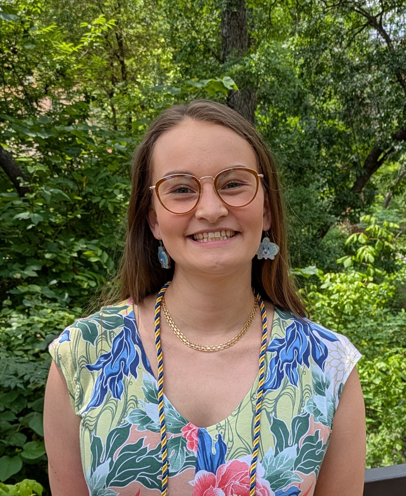

# Welcome!

  

     
I am a PhD candidate at the University of Texas at Austin. I research disability in higher engineering education and am passionate about creating a more sustainable engineering field through inclusion and accessibility. I received an M.S. in Mechanical Engineering in 2024 from UT, and a B.S. in Integrated Engineering and Humanities from Lehigh University in 2021. 

  

  

    
  

    

[Download my CV](files/LandgrenCV.pdf)

<a href=" https://www.linkedin.com/in/emilylandgren/?isSelfProfile=true">LinkedIn</a>  
<a href=" https://www.researchgate.net/profile/Emily-Landgren?ev=hdr_xprf">ResearchGate</a>  
<a href=" https://scholar.google.com/citations?user=N4YZVCgAAAAJ&hl=en&authuser=1">Google Scholar</a>

